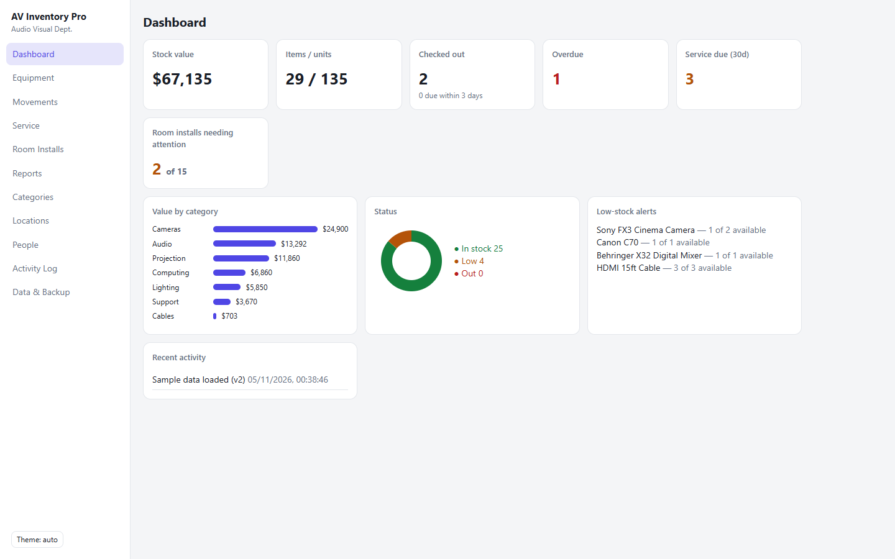
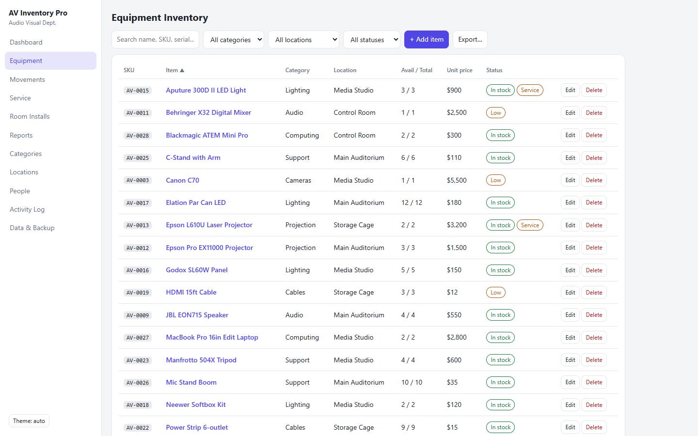
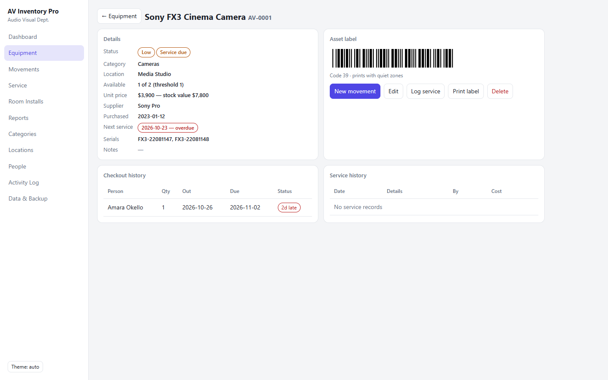
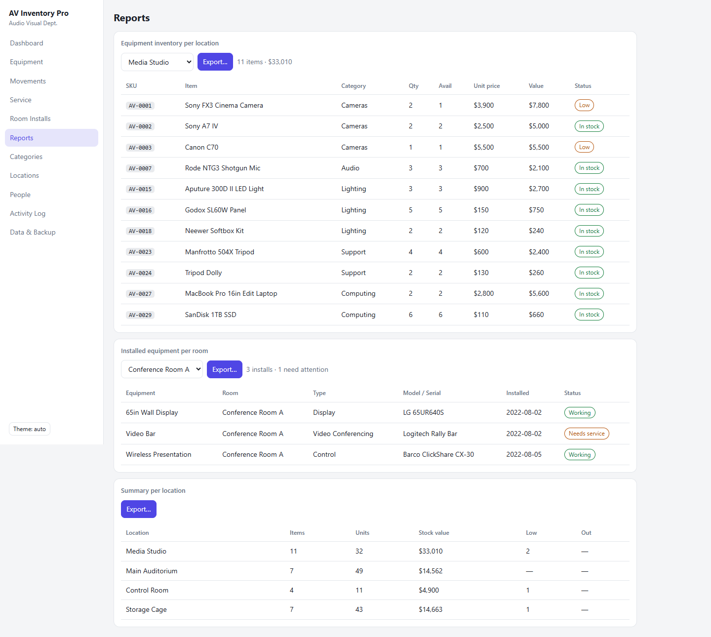
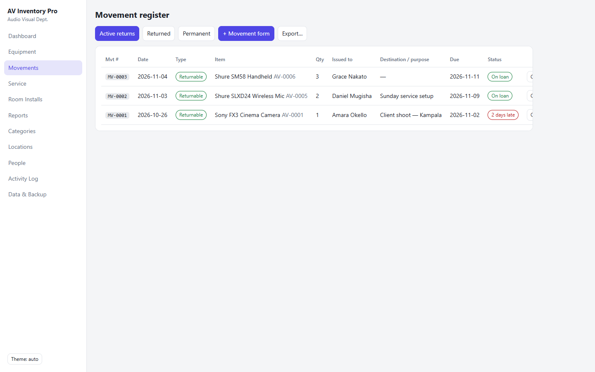
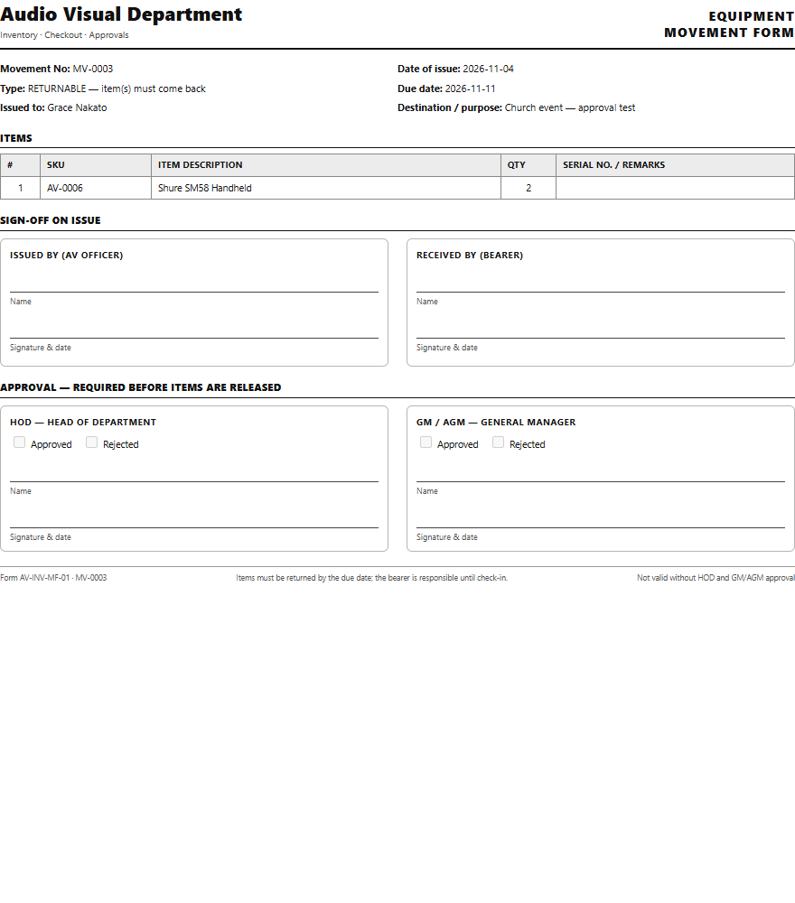

# AV Inventory Pro

**Offline-first equipment inventory for audio-visual / production departments.**
Checkout & check-in with quantities, per-item service history, room installs, printable
Code 39 asset labels, CSV export and JSON backup — in a single-page app with **zero
dependencies** and no build step.

**Live app:** https://sterio1production.github.io/av-inventory-pro/

| Dashboard | Equipment |
| --- | --- |
|  |  |

| Item detail (barcode + history) | Reports — per location / per room |
| --- | --- |
|  |  |

| Movements register | Printable approval form |
| --- | --- |
|  |  |

## Quick start

- **Online:** open the live URL above.
- **Offline:** download the folder and double-click `index.html` — it runs from `file://`
  with no server, no install, no internet.
- Data is stored in the browser's `localStorage` under the same key as the original
  prototype, so existing data upgrades in place (see *Migration* below).

## Features

- **Dashboard** — stock value, items/units, checked out (with due-soon count), overdue,
  service due within 30 days, room installs needing attention, value by category,
  stock-status donut, low-stock alerts, recent activity.
- **Equipment register** — auto-assigned `AV-####` SKUs (editable, uniqueness-checked),
  serial numbers, supplier, purchase date, next-service date, notes, per-item low-stock
  threshold and unit price. Search spans name/SKU/serials/supplier/notes; filter by
  category, location and status (in stock / low / out / service due); sortable columns.
- **Item detail page** — full record, live Code 39 barcode preview, one-click
  *New movement / Edit / Log service / Print label*, plus per-item movement and service
  history.
- **Movement register (returnable & permanent)** — replaces a plain checkout with proper
  issue vouchers: movement numbers (`MV-0001…`), **multi-item lines**, and three movement
  types — *Returnable* (loan with due date, must be checked back in; overdue badges),
  *Permanent transfer* (quantity physically moves to another location, creating/merging a
  stock line there) and *Permanent consumed / written off* (quantity leaves inventory with
  a recorded reason). Every movement stays in the register under its number.
- **Approval workflow (HOD & GM/AGM)** — every movement starts as *Pending*; the register
  shows per-movement HOD/GM chips, and the *Appr…* dialog records each approver's
  decision, name and date. **Printable form** (form ref `AV-INV-MF-01`): A4 voucher with
  company header, movement metadata, item table with serials, *Issued by / Received by*
  sign-off boxes and signature blocks for **HOD** and **GM/AGM** with Approved/Rejected
  tick boxes — print it from the movement dialog (*Save & print form*) or re-print any
  recorded movement from the register; recorded approvals pre-fill the form.
- **Reports** — select a specific **location** (Media Studio, Storage Cage…) or a specific
  **room** (Conference Room A/B, Board Room…) and generate that inventory list, plus a
  summary-per-location table (items, units, value, low/out counts) — each exportable.
- **Exports: Excel, PDF, CSV** — every list (equipment with current filters, movement
  register, service log, room installs, all reports) exports via one dialog to a real
  **.xlsx** (built in-app: ZIP + SpreadsheetML, verified in openpyxl), a paginated **PDF**
  (A4, landscape for wide tables, striped rows — written in-app, no libraries) or CSV.
- **Service & maintenance** — dated service records with technician and cost;
  next-service dates feed the dashboard "service due" widget and a status filter.
- **Room installs** — permanently installed equipment per room (displays, VC bars, DSPs…)
  with Working / Needs service / Offline states and per-room health cards.
- **Asset labels** — printable Code 39 barcode labels with quiet zones; the encoder's
  output was verified symbol-for-symbol against the [bwip-js](https://github.com/metafloor/bwip-js)
  reference implementation.
- **Setup lists** — categories, locations, people (with contact details).
- **Data & backup** — full JSON backup and restore with validation, storage usage stats,
  reset/erase.
- **GitHub sync** — data saved as a file in a repo, shared across devices (see below).
- **Activity log** — last 200 mutations, human-readable.
- **Dark mode** — follows the OS, with an Auto → Light → Dark toggle; responsive layout
  down to phone widths.

## Why it is designed this way

| Decision | Rationale |
| --- | --- |
| Single-page, zero dependencies | AV departments are not software teams. Any laptop or phone browser can run and maintain it; nothing to install or break. |
| Availability = qty − Σ(active loan qty) | Modelling loans as quantities (not one record per unit) matches how AV gear actually moves: cases of cables, pairs of monitors. |
| SKUs separate from serials | SKUs identify the *stock line* for labels and quick scanning; serials remain free-form per item for warranty/insurance paperwork. |
| Movement register, not just checkout | AV gear also leaves inventory forever: transfers between stores, consumed gaffer tape, written-off broken heads. Modelling both bases in one voucher keeps the audit trail honest. |
| Service records + next-service date | AV gear fails on maintenance schedules, not just on stock levels. The dashboard surfaces both. |
| Backup-first data view | `localStorage` is per-browser by design; the system treats export/import as a first-class routine, not an afterthought. |
| Same storage key + migration | Upgrades the original prototype's data in place — no re-entry. |

### Data model

```
items[]   { id, sku, n, cat, loc, qty, min, price, supplier, purchased, serials, nextsvc, notes }
co[]      { id, mvt, type, item, who, qty, out, due, back, reason, dest }  // mvt = MV-#### ; type: returnable | transfer | consumed
svc[]     { id, item, date, what, by, cost }
cats[] locs[] people[]  { id, n[, contact] }
rooms[]   { id, n }
inst[]    { id, n, room, type, sn, st, date, note }     // permanently installed gear
log[]     { t, m }
```

Everything persists to `localStorage` (`avinv-pro-1`) on every render.

### Migration from the original prototype

The original single-file prototype is included at
[`prototype/original-prototype.html`](prototype/original-prototype.html). On first load,
AV Inventory Pro v2 detects v1-shaped data (no SKUs, no service records, unit-only
checkouts), assigns SKUs, back-fills the new fields and defaults loan quantities to 1 —
availability and history are preserved.

## GitHub sync — data saved in a repo

Data can live in a GitHub repo as `data/inventory.json`, written through the GitHub
Contents API — so every laptop or phone shares one dataset while the app itself stays
static and serverless.

**One-time setup**

1. Create a **private** repo for data (e.g. `av-inventory-data`). If the repo is public,
   the data file is public too — don't put real inventory in a public repo.
2. Create a fine-grained personal access token:
   [github.com/settings/personal-access-tokens/new](https://github.com/settings/personal-access-tokens/new)
   → Repository access: *Only select repositories* → pick the data repo →
   Permissions → Contents: **Read and write**.
3. In the app: **Data & Backup → GitHub sync**, fill owner / repo / branch / file path,
   paste the token, **Save & test**. Then **Push now** once, and turn **auto-sync** on.

**How it behaves**

- *Auto-push* — ~15 s after your last change, the app commits the data file
  (`AV inventory data sync — <date>`). Idle debounce keeps commit noise low.
- *Auto-pull* — on startup the app adopts the remote file (if this browser has no
  unsynced edits); with unsynced local edits it asks before overwriting either side.
- *Conflicts* — last writer wins; a stale push is rejected (409) and the app tells you
  to pull first. For a small team this is usually enough; heavy concurrent editing is a
  job for a real backend (see roadmap).
- *Token security* — the token is stored only in that browser's `localStorage` and sent
  only to `api.github.com` over HTTPS. Scope it to the single data repo with
  Contents-only access. Never paste a token into issues/commits.
- The file is the same shape as the JSON backup (`{app, ver, exported, data}`), so a
  synced file can also be restored with **Restore backup**.

## Printing asset labels

Open an item → **Print label** → a 2.25 × 1.25 in label with the item name, Code 39
barcode of the SKU, and category/location line opens ready to print. The barcode is pure
SVG (no libraries): narrow:wide = 2:5, one narrow inter-character gap, quiet zones on
both sides. Any 2-of-9-capable scanner reads it.

## Running from GitHub Pages

The repo is plain static files — Pages serves it as-is. To host it yourself, point any
static web server at the folder, or use the repo as-is:

```bash
npx serve .          # or: python -m http.server
```

## Roadmap ideas

- Reservation requests with approval flow
- Kits/bundles (check out a "camera package" as one unit)
- Consumables vs serialized assets split
- Multi-user sync backend (the UI is already a single state object)

## Credits & license

Built on the *Inventory Management Pro — Audio Visual* single-file prototype, included at
[`prototype/original-prototype.html`](prototype/original-prototype.html). The header now
reads **Audio Visual Department** (edit the `ORG` constant in `app.js` for your own
organisation). MIT licensed — see [LICENSE](LICENSE).
